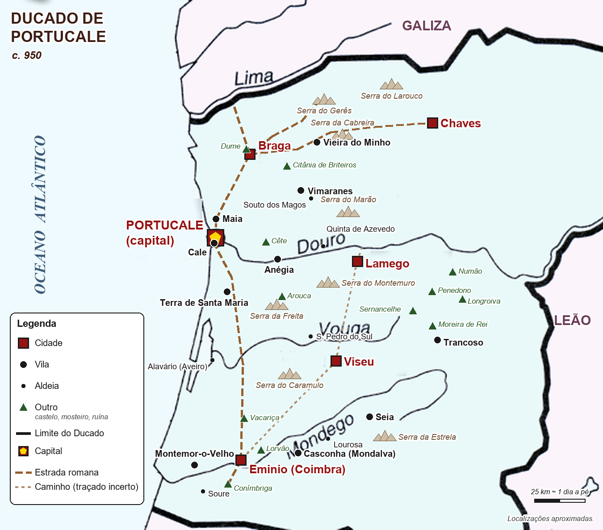

# Ducado de Portucale

**Um Portugal que nunca existiu, no ano 950.** Um cenário de campanha original para um RPG de mesa (Daggerheart™ Compatible), feito a partir das lendas portuguesas: mouras encantadas nas fontes, olharapos nas serras, afogados nas noites de cheia. Este repositório é o **site para os jogadores**: tudo o que precisam de saber para criar uma personagem e entrar no mundo, sem spoilers.

🔗 **Site:** https://ruirodrigues-lab.github.io/Conspiracao-do-ducado/



---

## O projeto

O Ducado de Portucale é uma campanha caseira que se joga sobretudo em **one-shots com grupos que mudam de sessão para sessão**. Por isso o material para jogadores tem de se explicar sozinho: quem chega pela primeira vez abre o site, escolhe uma classe, lê as lendas da terra de onde vem e está pronto para jogar.

O projeto completo tem duas partes:

| Parte | O que é | Onde está |
|---|---|---|
| **Material dos jogadores** | O mundo, o mapa, as regras resumidas, a criação de personagem, as lendas e as notas de mesa | **Este repositório** |
| **Material do mestre** | Missões por lugar, encontros, bestiário, mapas e notas só do mestre, simuladores de sessões | Privado (spoilers) |

A separação é uma regra do projeto: nada do material do mestre entra aqui.

## O site (6 páginas)

| Página | O que tem |
|---|---|
| **Início** (`index.html`) | O pitch, o tom e os temas, como funciona o mundo e as diferenças em relação às regras base |
| **Mapa** (`mapa.html`) | Mapa clicável com 34 lugares: cada pino abre a descrição e as distâncias a pé. Filtros por tipo de lugar que levam à secção certa da lista. Tabela de distâncias e lugares fora do Ducado |
| **Regras** (`regras.html`) | Resumo das regras do SRD 2.0 para ter à mão durante o jogo, com as duas regras da casa da campanha |
| **Personagem** (`personagem.html`) | Criação de personagem passo a passo: as classes com a cara do Ducado, as ancestralidades, as comunidades com perguntas de background ligadas a lugares reais |
| **Lendas** (`lendas.html`) | As lendas do povo, arrumadas por onde se encontram: fontes e águas, serras, encruzilhadas, adros e castros, a casa à noite |
| **À mesa** (`mesa.html`) | Princípios de jogador, perguntas para a sessão zero e ferramentas de segurança |

## Destaques técnicos

- **Site estático, sem frameworks.** HTML, CSS e JavaScript simples, servidos pelo GitHub Pages. Não há dependências nem passo de build no browser.
- **Gerador em Python (só biblioteca padrão).** `fonte/site.py` junta o texto de cada página com o cabeçalho, o menu e o rodapé comuns. Também constrói a página do mapa: os pinos, os cartões de cada lugar e as distâncias, calculadas a partir de uma só lista de rotas.
- **Mapa desenhado por código a partir de coordenadas reais.** Cada lugar é guardado em latitude e longitude. Um script com Pillow converte as coordenadas para píxeis sobre um mapa-base da região. A conversão usa uma transformação afim ajustada por mínimos quadrados a seis cidades de controlo, mais uma correção por distância inversa para os pontos de controlo baterem certo. O mesmo script desenha as estradas romanas e as serras, e exporta a posição de cada lugar em percentagem (`fonte/posicoes.json`) para os pinos do site ficarem sempre alinhados com a imagem.
- **Mapa interativo em JavaScript simples.** Tocar num pino mostra o lugar por baixo do mapa e guarda-o no endereço (`#lugar-…`), para se poder partilhar a ligação. Os filtros mostram só um tipo de lugar no mapa e na lista e levam à secção respetiva.
- **Tema escuro em violeta e ouro.** Cores definidas como variáveis CSS, tipografia de iluminura (Uncial Antiqua) com Alegreya Sans.
- **Acessível e responsivo.** Funciona em telemóvel (sem scroll horizontal; as tabelas largas deslizam dentro de uma caixa). Botões com `aria-pressed`, foco visível, `prefers-reduced-motion` respeitado e uma folha de estilo para imprimir.
- **Base histórica.** Os lugares que não vêm do texto original têm base documental do século X: *civitates* e castelos de fronteira (segundo o estudo de Mário Jorge Barroca), mosteiros, testemunhos moçárabes e salinas.
- **Verificado por testes.** No projeto completo, uma bateria de 474 testes automáticos confirma que o site, os mapas e o material do mestre dizem o mesmo. Por exemplo, cada lugar do mapa tem pino, cartão e secção. Os testes confirmam também que as distâncias batem certo em todo o lado, que o site não tem spoilers e que a licença está cumprida. Esses testes ficam no repositório privado.

## Estrutura

```
docs/                    o site publicado (GitHub Pages)
  index.html, mapa.html, regras.html, personagem.html, lendas.html, mesa.html
  estilo.css             tema e layout (editado diretamente)
  site.js                mapa clicável e filtros (editado diretamente)
  img/mapa-ducado.png    o mapa, gerado por código
fonte/
  site.py                gera as 6 páginas de docs/
  posicoes.json          posição de cada lugar no mapa, em percentagem
  paginas/               o texto de cada página
```

## Ver no computador

```bash
python -m http.server 8765 --directory docs
```

Depois abre `http://localhost:8765`.

## Mudar alguma coisa

1. Edita o texto em `fonte/paginas/`. As descrições dos lugares estão no dicionário `L` de `fonte/site.py`, e as rotas na lista `DIST`, que serve para a tabela e para as distâncias de cada lugar.
2. Gera as páginas: `python -I fonte/site.py`.
3. Vê no computador (acima) e envia para o GitHub.

`estilo.css` e `site.js` editam-se diretamente em `docs/`.

**Mapa:** a imagem e o `posicoes.json` são gerados por scripts que ficam fora deste repositório, porque também desenham os mapas do mestre. Quando um lugar muda, gera-se o mapa outra vez e depois as páginas.

## Publicar no GitHub Pages

1. Envia esta pasta como raiz do repositório.
2. No GitHub: **Settings → Pages → Build and deployment → Deploy from a branch**, ramo `main`, pasta **`/docs`**.
3. O site fica em https://ruirodrigues-lab.github.io/Conspiracao-do-ducado/.

## Licença (DPCGL 2.0)

O site partilha material do SRD 2.0, por isso segue a Darrington Press Community Gaming License 2.0 (secção 4.1, uso não comercial). O rodapé de todas as páginas tem:
- a atribuição oficial: *"This product includes materials from the Daggerheart System Reference Document 2.0, © Critical Role, LLC. under the terms of the Darrington Press Community Gaming (DPCGL) License. More information can be found at https://www.daggerheart.com. There are no previous modifications by others."*;
- as ligações para o SRD (daggerheart.com/srd) e para a licença (darringtonpress.com/license);
- a indicação de que as regras foram resumidas e traduzidas por nós.

**Regras do nome "Daggerheart"** (secção 2.5): não pode aparecer em títulos nem na "capa" (o topo da página inicial); no texto descritivo leva "Compatible" ao lado ("Daggerheart™ Compatible"). Se o projeto for algum dia comercial, a secção 4.2 pede ainda o logótipo de conteúdo da comunidade.

O cenário, os textos e o mapa são originais. As lendas são do povo português.
